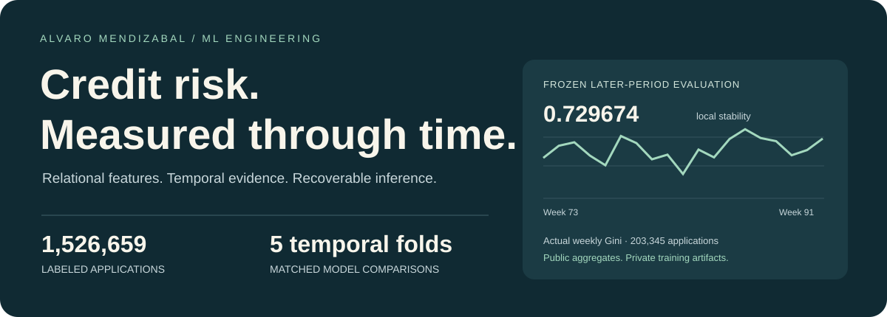
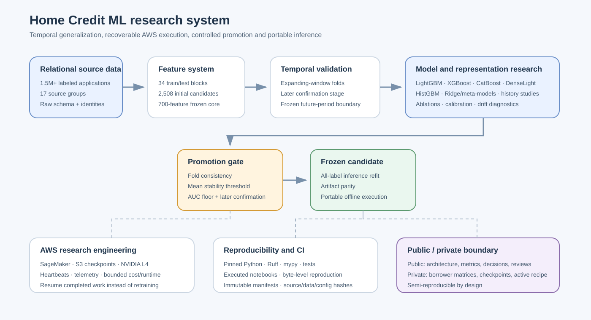
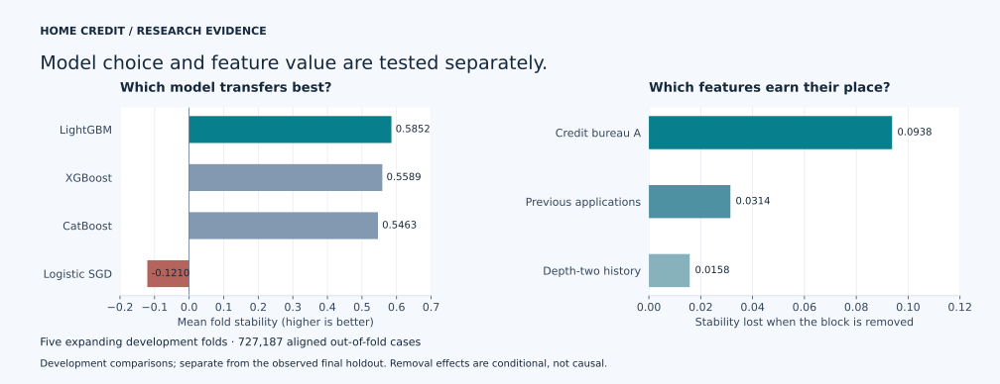

# Home Credit · Temporal risk modeling



**Alvaro Mendizabal · ML engineering · Relational data · Temporal validation**

[](https://github.com/alvaromendizabal/home-credit-model-stability/actions/workflows/ci.yml)
[](https://github.com/alvaromendizabal/home-credit-model-stability/actions/workflows/public-demo.yml)

I built a credit-risk research and inference system that joins relational histories, selects features using training data only, compares models across time and verifies the complete prediction handoff. The maintained release shows the selected pipeline and its necessary controls—not unpromoted follow-on studies.

[**Explore Stability Lab ↗**](https://home-credit-stability-lab.tartmacaw2.chatgpt.site) · [Visual engineering brief](reports/portfolio/brief/index.html) · [Case study](docs/case_study.md) · [Model card](MODEL_CARD.md)

## Scale and engineering

| Scope | Recorded result | Implementation |
|---|---|---|
| Relational data | **1,526,659 applications · 17 source groups** | [Schema and joins](src/home_credit/data) |
| Selected representation | **2,508 candidates → 700 features** | [Feature construction](src/home_credit/features), [training-only screening](src/home_credit/modeling/screening.py) |
| Controlled benchmark | **Four model families × five expanding folds · 727,187 OOF cases** | [Temporal protocol](src/home_credit/validation), [model runner](src/home_credit/modeling/runner.py) |
| Release delivery | Native-model reload, exact case order and verified reuse | [Release workflow](src/home_credit/modeling/release_workflow.py), [inference](src/home_credit/modeling/inference.py) |



## Final measured results

| Artifact and population | Recorded metrics |
|---|---|
| Original frozen release · 203,345 later-period applications | **0.875759 ROC AUC · 0.729674 weekly-Gini stability** |
| Same population · probability diagnostics | **0.193755 average precision · 0.019282 Brier · 0.080695 log loss** |
| Original all-label inference refit · external evaluation | **0.56062 public · 0.47429 private** |
| Later tree + histogram + neural ensemble · separate external evaluation | **0.56035 public · 0.47652 private** |

The local **0.729674** stability result is not an external competition score. The later all-label ensemble is a different private artifact, not an identical rerun of the original public reference. Weeks 73–91 were opened after the original selection and are now observed; later development cannot treat them as a fresh holdout. [Original release](reports/model_release/evaluation.json) · [Original external receipt](reports/kaggle_submission/execution.json) · [Later final result](reports/post_release_frontier/october_2026.md)

## Evidence for the selected features

Removing bureau A, previous applications or depth-two history reduced mean development stability by **0.093813**, **0.031440** and **0.015762**, respectively. These are predictive removal effects, not causal effects on borrowers. [Controlled ablations](reports/feature_ablation/README.md)



## Run a public review

With Python 3.12, no credentials or private data:

```bash
python3 scripts/review_public_evidence.py --output artifacts/public-review
python3 scripts/review_public_evidence.py --output artifacts/public-review --check
python3 scripts/review_portfolio_brief.py
```

Open `artifacts/public-review/index.html`. The standard-library implementation checks pinned original inputs, recalculates weekly-Gini stability and distinguishes source-reported AUC from recomputed aggregate statistics. Repeating a completed run checks its outputs before reuse. It does not claim to reconstruct unavailable borrower predictions.

The locked environment also exercises real small-data model fits, train-only encoders, temporal leakage tests, checkpoint corruption/recovery, exact-ID inference and canonical executed benchmark, selection and release notebooks. [Full commands](docs/public_reproducibility.md)

## A focused publication

The retained project includes the feature pipeline, necessary model controls, frozen selection/release/inference code, original result records, six canonical notebooks and an interactive stability explanation. Unpromoted calibration, categorical/history extensions, proposed neural experiments, their launchers and redundant notebooks are retired.

Private borrower records, fitted research weights, active feature identities and current ensemble specifications are not distributed. The browser operates on explicitly synthetic weekly aggregates; it is not a deployed credit decision system. No lending-policy impact, fairness certification or production readiness is claimed. [Disclosure](docs/public_reproducibility.md#disclosure-boundary)
